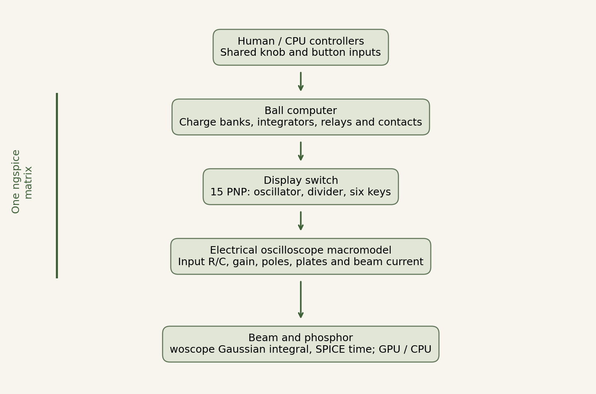

**English** · [Русский](README.ru.md)

# Tennis for Two — circuit reconstruction

**A reconstruction of the 1958 tennis game that runs in a web browser.** Two players hit a ball over a net, turn knobs to choose a shot angle and press buttons to hit. The original game, built by William Higinbotham and Robert Dvorak at Brookhaven National Laboratory, used an analog computer and an oscilloscope to show the court from the side.

This project recreates how that equipment worked. The ball's motion comes from a simulation of the electrical circuit: capacitor charge, amplifier outputs, relay switching and transistor behavior. The display follows the calculated beam signal, and the controls have their own mechanical model. You can play the game, inspect its circuits and repeat the engineering checks.

Part of the [Imperial School Laboratory](https://games.oopssre.ru/en/lab/) at the [Imperial School Arcade](https://games.oopssre.ru/).

[Play in the browser](https://games.oopssre.ru/en/play/tennis-for-two/) · [Research on GitHub Pages](https://malyhind.github.io/tennis-for-two/app/docs/research.en.html) · [Laboratory materials](https://games.oopssre.ru/en/lab/tennis-for-two.html) · [Research PDF](app/docs/Gremlin_Tennis_Research_0.8.4.en.pdf)

Release **0.8.7** improves knob and button input. **Me and Opponent** gives both controllers to people; **Me and Fox** uses an automatic Fox player. The looped demo and complete bilingual research are included. See [release notes](RELEASE.md).

## What is simulated

- **Electrical circuit.** The ball computer, passive supply, 15-transistor display switch and oscilloscope electrical model run together in one continuous ngspice simulation, compiled to WebAssembly. Their accepted voltages and currents determine the displayed trace.
- **Oscilloscope display.** Beam deflection and intensity, phosphor excitation and decay, and a declared glass-optics model. WebGL2 renders the screen when available; a CPU implementation provides a fallback.
- **Mechanical controls.** Planck.js calculates knob inertia, friction and backlash, button travel, springs and contact closure. Mechanics and glass can be switched on and off.
- **Players.** Play with another person, against a CPU, or watch Gremlin and Fox play. CPU players use the visible ball position and operate the ordinary controls above the circuit model.

An optional recorded demo plays at real-time speed while the beam, phosphor and glass are rendered live. A ready looped recording is included; live simulation remains the default. Recording and playback are described in the [demo documentation](app/docs/demo-mode.en.md).

## Engineering changes

- **Declared circuit interpretations.** Court-limit detection, the net-response circuit and stroke interlock use documented working equivalents where the surviving drawings and component data leave gaps. The [correction register](app/docs/corrections.json) records each choice and its reason.
- **Solver optimization.** Behavioral-source expressions are prepared for repeated execution, with shared results reused within a single evaluation. The implementation preserves double precision and dependent-operation order. The [optimization study](app/docs/engine-optimization.en.md) and [prepared evaluator](app/docs/prepared-evaluator.en.md) describe the patches and comparisons.
- **Long-running browser sessions.** State checkpoints transfer the calculation to a fresh worker to bound retained WASM memory. If a candidate fails to restore with the handled initialization error, the active worker continues the accepted session. See [continuation recovery](app/docs/continuation-recovery.en.md).

These are documented changes in this implementation. Historical interpretations, software fixes and measured numerical differences are identified separately in the research.

## Schematics, sources and patches

The electrical model is based on Brookhaven's surviving drawings. It runs on our modified ngspice 45.2 build using the EEcircuit/Emscripten bridge. The beam integral is adapted from woscope; Planck.js provides controller mechanics. [Authors and reuse](ACKNOWLEDGEMENTS.md) identifies what was adopted, adapted or only studied.

| Material | Open |
| --- | --- |
| Original Brookhaven drawings | [1958 ball computer](app/docs/figures/bnl-schematic-1.jpg) · [1959 display switch](app/docs/figures/bnl-schematic-2.jpg) |
| Our connection diagrams | [Ball computer](app/docs/figures/computing-chain.en.svg) · [Display switch](app/docs/figures/display-topology.en.svg) · [Human/CPU controls](app/docs/figures/operator-layer.en.svg) |
| Executable component connections | [Ball computer](app/tennis.cir) · [15-transistor switch](app/display-switch.cir) · [Oscilloscope](app/scope.cir) |
| Joined circuit | [Saved netlist](app/joint.cir) · [Runtime circuit assembler](app/joint-circuit.js) |
| Parameters and reconstruction choices | [Circuit model](app/docs/model.json) · [Correction register](app/docs/corrections.json) · [Supply and scope parameters](app/instrument-model.js) |
| Our ngspice changes | [Cumulative evaluator patch](app/vendor/source/ngspice45.2-tft-eval2.patch) · [Build and provenance](app/vendor/PROVENANCE.json) |



The diagrams show the architecture; the SPICE netlists specify the component connections. The runtime assembler adds the control inputs and analysis scenario. The [schematics guide](app/docs/SCHEMATICS.en.md) explains the files and standalone examples.

## Historical basis and accuracy

The reconstruction uses surviving circuit drawings, manufacturer documents, and accounts of hardware restorations, including Peter Takacs's work at Brookhaven. The ball-computer drawing dates from 1958; the display-switch drawing dates from 1959. The original machine is unavailable for direct measurement.

We document the adopted component models, inferred parameters and limits of the comparison. Numerical tests check the implemented model; historical claims are tied to their sources. See the [research overview](app/docs/RESEARCH.en.md), [sources](app/docs/sources.en.md), and [schematics and substitutions](app/docs/SCHEMATICS.en.md).

## Documentation

- [Complete research on GitHub Pages](https://malyhind.github.io/tennis-for-two/app/docs/research.en.html).
- [Research and project materials on the Laboratory website](https://games.oopssre.ru/en/lab/tennis-for-two.html).
- [Research text in the repository](app/docs/RESEARCH.en.md) and [schematics guide](app/docs/SCHEMATICS.en.md).
- [Research PDF](app/docs/Gremlin_Tennis_Research_0.8.4.en.pdf), with diagrams, sources, measurements and stated assumptions.
- [Reproducing the model and running checks](REPRODUCING.md).
- [Numerical methods](app/docs/METHODS.en.md), [controller mechanics](app/docs/mechanics.en.md), and [glass optics](app/docs/glass-optics.en.md).
- [Authors, dependencies and reuse](ACKNOWLEDGEMENTS.md).

The HTML research and interactive benches are included in the source tree. Once the site is running, open `/checks/index.en.html` to check the browser, mechanics, optics and continuous circuit, or to reach the transistor and CPU/WebGL benches. Results identify the tested environment and unavailable features.

## Run from source

For local development, use **Node.js 24 or later**. From the repository root:

```sh
npm start
```

Open **http://127.0.0.1:8080/**. The command serves the ready HTML, JavaScript and WASM using Node's built-in HTTP server. The browser runs the game; the required browser dependencies and compiled solver are included.

The same files can be served by a static web host. Local development requires HTTP so that the browser can load ES modules, workers and WASM.

## Development and checks

The instrument reads its play-mode assignments from `app/play-modes.js`.

`app/` contains the browser code, SPICE circuits and dependencies. `tests/` contains the numerical and browser checks. `tools/` contains supporting development utilities.

```sh
npm test
```

Additional suites and their prerequisites are listed in [REPRODUCING.md](REPRODUCING.md). Circuit changes should include the relevant numerical comparisons and a source or explanation for changed parameters.

For a bug report, include the browser and operating system, steps to reproduce, and the JSON report from the browser checks if available. Research contributions should identify their source and distinguish measurements from reconstruction choices.

## License and authors

Our code, circuit descriptions and writing use the [MIT license](LICENSE). External components, archival drawings and manufacturer documents retain their own licenses and attribution; see [ACKNOWLEDGEMENTS.md](ACKNOWLEDGEMENTS.md).

**Dmitry Malykhin / Gremlin.** Research and development in dialogue with ChatGPT (OpenAI).

[Imperial School Laboratory](https://games.oopssre.ru/en/lab/) · [Imperial School Arcade](https://games.oopssre.ru/) · [Imperial School Engineer](https://oopssre.ru/) · [Channel @oopsSRE](https://t.me/oopsSRE) · [Contact @Timon_Crazy](https://t.me/Timon_Crazy) · [i@dmalyhin.ru](mailto:i@dmalyhin.ru)
