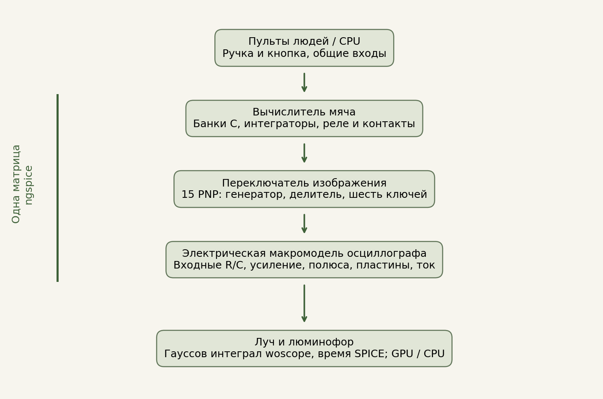

[English](README.md) · **Русский**

# Tennis for Two — реконструкция электрической схемы

**Браузерная реконструкция теннисной игры 1958 года.** Два игрока перебрасывают мяч через сетку: ручкой выбирают угол удара, кнопкой отбивают мяч. В оригинальной игре, созданной Уильямом Хигинботамом и Робертом Двораком в Брукхейвенской национальной лаборатории, движение рассчитывал аналоговый компьютер, а корт показывал осциллограф — вид сбоку.

Этот проект воссоздаёт работу той аппаратуры. Движение мяча получается из расчёта электрической схемы: заряда конденсаторов, напряжений усилителей, переключений реле и поведения транзисторов. Экран показывает рассчитанную трассу луча, а ручки и кнопки имеют механическую модель. Здесь можно сыграть, изучить схемы и повторить инженерные проверки.

Проект [Лаборатории Школы Империи](https://games.oopssre.ru/lab/) в составе [Аркадного зала Школы Империи](https://games.oopssre.ru/).

[Открыть игру](https://games.oopssre.ru/play/tennis-for-two/) · [Исследование на GitHub Pages](https://malyhind.github.io/tennis-for-two/app/docs/research.html) · [Материалы в Лаборатории](https://games.oopssre.ru/lab/tennis-for-two.html) · [Исследование в PDF](app/docs/Gremlin_Tennis_Research_0.8.4.pdf)

Выпуск **0.8.6** исправляет управление ручками и кнопками. В режиме **«Я и Лиса»** Лиса играет автоматически; режим **«Два игрока»** отдаёт оба пульта людям. Зацикленное демо и полное исследование на двух языках входят в комплект. См. [описание выпуска](RELEASE.md).

## Что моделируется

- **Электрическая схема.** Вычислитель мяча, пассивное питание, переключатель изображения из 15 транзисторов и электрическая модель осциллографа работают вместе в непрерывном расчёте ngspice, собранного в WebAssembly. Рассчитанные напряжения и токи определяют трассу на экране.
- **Экран осциллографа.** Отклонение и яркость луча, возбуждение и затухание люминофора, принятая модель оптики стекла. При наличии WebGL2 экран рассчитывается на GPU; предусмотрен вариант на CPU.
- **Механические пульты.** Planck.js рассчитывает инерцию, трение и люфт ручек, ход кнопок, пружины и момент замыкания контактов. Механику и стекло можно включать и выключать.
- **Игроки.** Можно играть вдвоём, против компьютера или смотреть матч Гремлина и Лисы. Компьютерные игроки получают видимое положение мяча и управляют обычными пультами поверх схемы.

Дополнительный режим демо воспроизводит заранее рассчитанный матч в реальном темпе; луч, люминофор и стекло рассчитываются во время просмотра. Готовая зацикленная запись входит в комплект; по умолчанию работает живой расчёт. Подготовка записи и воспроизведение описаны в [документации демо](app/docs/demo-mode.md).

## Наши доработки

- **Явные схемные решения.** Для концевых детекторов, реакции на сетку и блокировки повторного удара заданы рабочие эквиваленты там, где сохранившиеся чертежи и данные компонентов оставляют пробелы. В [реестре решений](app/docs/corrections.json) указаны каждая замена и её причина.
- **Оптимизация решателя.** Выражения поведенческих источников подготавливаются для повторного исполнения, общие результаты переиспользуются внутри одного вычисления. Сохранены двойная точность и порядок зависимых операций. [Исследование ускорения](app/docs/engine-optimization.md) и [подготовленный вычислитель](app/docs/prepared-evaluator.md) содержат правки и сравнения.
- **Продолжительная работа в браузере.** Контрольные точки переносят расчёт в новый Worker, ограничивая удерживаемую память WASM. При обработанной ошибке восстановления нового Worker текущий сеанс продолжает работу. См. [восстановление непрерывного расчёта](app/docs/continuation-recovery.md).

Это документированные доработки нашей реализации. Исторические интерпретации, исправления программы и измеренные численные расхождения разобраны в исследовании отдельно.

## Схемы, исходники и правки

Электрическая модель основана на сохранившихся чертежах Брукхейвена. Она работает на нашей доработанной сборке ngspice 45.2 с оболочкой EEcircuit/Emscripten. Интеграл луча адаптирован из woscope; механику пультов рассчитывает Planck.js. В [реестре авторов и заимствований](ACKNOWLEDGEMENTS.ru.md) указано, что использовано, адаптировано или изучено для сравнения.

| Материал | Открыть |
| --- | --- |
| Оригинальные чертежи Брукхейвена | [Вычислитель, 1958](app/docs/figures/bnl-schematic-1.jpg) · [Переключатель, 1959](app/docs/figures/bnl-schematic-2.jpg) |
| Наши схемы связей | [Вычислитель мяча](app/docs/figures/computing-chain.svg) · [Переключатель изображения](app/docs/figures/display-topology.svg) · [Пульты человека и CPU](app/docs/figures/operator-layer.svg) |
| Исполняемые соединения компонентов | [Вычислитель](app/tennis.cir) · [15 транзисторов](app/display-switch.cir) · [Осциллограф](app/scope.cir) |
| Объединённая схема | [Сохранённый netlist](app/joint.cir) · [Сборщик рабочего тракта](app/joint-circuit.js) |
| Параметры и решения реконструкции | [Модель схемы](app/docs/model.json) · [Реестр решений](app/docs/corrections.json) · [Питание и осциллограф](app/instrument-model.js) |
| Наши изменения ngspice | [Кумулятивный патч вычислителя](app/vendor/source/ngspice45.2-tft-eval2.patch) · [Сборка и происхождение](app/vendor/PROVENANCE.json) |



Рисунки показывают структуру; SPICE-netlist задаёт соединения компонентов. Сборщик рабочего тракта добавляет управляющие входы и сценарий расчёта. [Указатель схем](app/docs/SCHEMATICS.md) объясняет назначение файлов и самостоятельных примеров.

## Исторические основания и точность

Реконструкция опирается на сохранившиеся чертежи, документы изготовителей и материалы аппаратных восстановлений, включая работу Питера Такача в Брукхейвене. Чертёж вычислителя датирован 1958 годом, переключателя изображения — 1959-м. Оригинальная установка недоступна для прямых измерений.

Принятые модели деталей, восстановленные параметры и границы сравнения описаны в исследовании. Численные тесты проверяют реализованную модель; исторические утверждения связаны с источниками. См. [обзор исследования](app/docs/RESEARCH.md), [источники](app/docs/sources.md) и [схемы с принятыми заменами](app/docs/SCHEMATICS.md).

## Документация

- [Полное исследование на GitHub Pages](https://malyhind.github.io/tennis-for-two/app/docs/research.html).
- [Исследование и материалы на сайте Лаборатории](https://games.oopssre.ru/lab/tennis-for-two.html).
- [Текст исследования в репозитории](app/docs/RESEARCH.md) и [указатель схем](app/docs/SCHEMATICS.md).
- [Исследование в PDF](app/docs/Gremlin_Tennis_Research_0.8.4.pdf): схемы, источники, измерения и принятые допущения.
- [Повторение расчётов и запуск проверок](REPRODUCING.ru.md).
- [Численные методы](app/docs/METHODS.md), [механика пультов](app/docs/mechanics.md) и [оптика стекла](app/docs/glass-optics.md).
- [Авторы, зависимости и заимствования](ACKNOWLEDGEMENTS.ru.md).

HTML-версия исследования и интерактивные стенды входят в исходники. После запуска сайта откройте `/checks/index.html`: там доступны проверки браузера, механики, оптики и непрерывной схемы, а также переходы к транзисторному стенду и сравнению экрана CPU/WebGL. В результатах указаны среда проверки и недоступные возможности.

## Запуск из исходников

Для локальной разработки нужен **Node.js 24 или новее**. Из корня репозитория:

```sh
npm start
```

Откройте **http://127.0.0.1:8080/**. Команда раздаёт готовые HTML, JavaScript и WASM через встроенный HTTP-сервер Node. Игра выполняется в браузере; браузерные зависимости и собранный решатель приложены.

Те же файлы можно разместить на статическом веб-хостинге. Для локальной работы нужен HTTP, через который браузер загружает ES-модули, workers и WASM.

## Разработка и проверки

В `app/` находятся браузерный код, SPICE-схемы и зависимости. В `tests/` — численные и браузерные проверки. В `tools/` — вспомогательные инструменты разработки.

```sh
npm test
```

Дополнительные проверки и их требования перечислены в [REPRODUCING.ru.md](REPRODUCING.ru.md). К изменению схемы стоит приложить соответствующие численные сравнения и источник либо обоснование новых параметров.

Для сообщения об ошибке укажите браузер, операционную систему, последовательность действий и, если доступен, JSON-отчёт браузерных проверок. Для исследовательских дополнений укажите источник и отделите измеренные данные от принятых параметров реконструкции.

## Лицензия и авторы

Наш код, схемные описания и тексты выпускаются под [MIT](LICENSE). Внешние компоненты, архивные чертежи и документы изготовителей сохраняют собственные лицензии и авторство; см. [ACKNOWLEDGEMENTS.ru.md](ACKNOWLEDGEMENTS.ru.md).

**Дмитрий Малыхин / Гремлин.** Разработка и исследование в диалоге с ChatGPT (OpenAI).

[Лаборатория Школы Империи](https://games.oopssre.ru/lab/) · [Аркадный зал Школы Империи](https://games.oopssre.ru/) · [Инженер школы Империи](https://oopssre.ru/) · [Канал @oopsSRE](https://t.me/oopsSRE) · [Связь @Timon_Crazy](https://t.me/Timon_Crazy) · [i@dmalyhin.ru](mailto:i@dmalyhin.ru)
